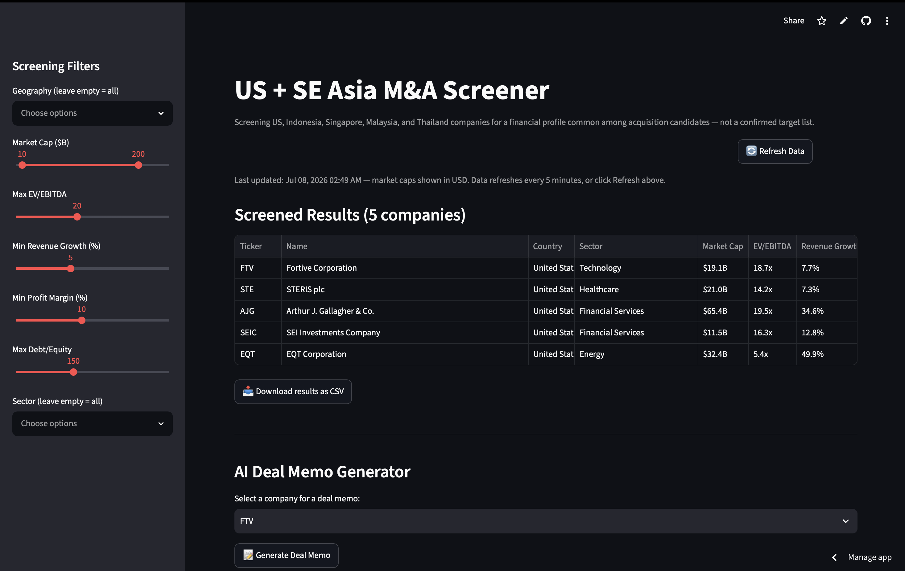
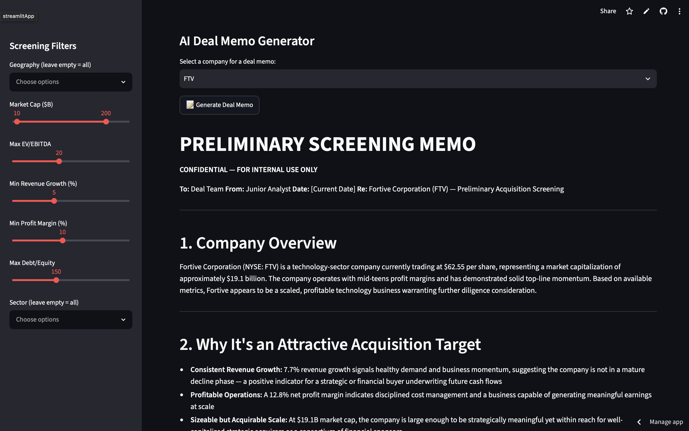
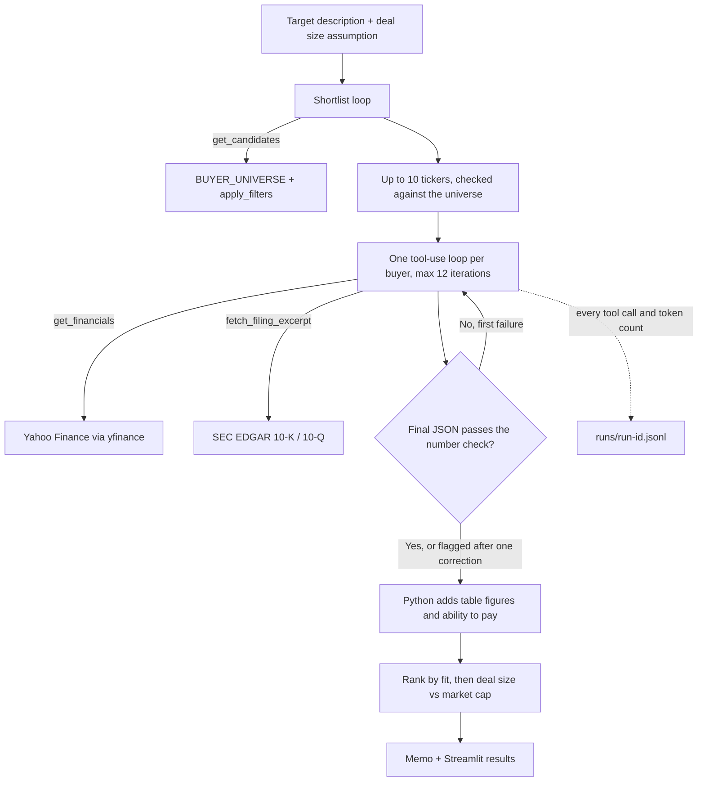

# US + SE Asia M&A Screener

**Live app:** [edric-ma-screener.streamlit.app](https://edric-ma-screener.streamlit.app)

A cross-border M&A screening tool covering the US, Indonesia, Singapore, Malaysia, and Thailand, with an AI-generated preliminary deal memo for any company that clears the filters, plus an AI agent that builds a ranked buyer map for a target.

## Versions

- **V1:** the screener and a single-call deal memo
- **V2 (current):** adds the AI buyer analysis agent, with code-checked evidence and calculated fit scores
- **V3 (planned):** adds a hand-entered private-buyer list, clearly labeled as manual

## Why I built this

Most screening tools stop at the US or treat Southeast Asia as an afterthought. I wanted something that covers both — screening for companies with a financial profile common among acquisition candidates (reasonable valuation, growth, manageable leverage) across five markets, with currency-adjusted comparisons so a $2B Indonesian company and a $2B US company are actually being compared on equal footing.

## What it does

- Screens 38 companies across five markets on market cap, EV/EBITDA, revenue growth, profit margin, and debt/equity
- Screens banks and similar financials on price-to-book and ROE instead, because EV/EBITDA and debt/equity don't work when debt funds the business
- Converts every market cap and revenue figure to USD using live FX rates, since SE Asia figures come back in local currency
- Filters by geography and sector
- Generates a preliminary screening memo (company overview, why it's attractive, key risks, valuation range) via the Claude API for any company in the filtered results
- Exports results as CSV
- Falls back to a dated copy of the screener data when Yahoo Finance blocks the server, and labels it as saved data
- Builds a ranked buyer universe for a target description using an AI agent ([sample memo](docs/sample_buyer_memo.md))

## Screenshots




## AI buyer analysis

Give it a target such as "mid-size crypto custody company, US-based" and a deal size assumption. It shortlists buyers from a curated universe of 15 public US companies, researches each one in SEC filings, scores strategic fit, and writes a sourced memo.



### How it's built

| File | What it does |
|---|---|
| `agent/agent.py` | The hand-written tool-use loop, token cap, retries, cost tracking, and CLI |
| `agent/tools.py` | `get_candidates`, `get_financials`, `fetch_filing_excerpt`, and the ability-to-pay math |
| `agent/verify.py` | The number check |
| `agent/schemas.py` | Pydantic models for the output |
| `agent/report.py` | Renders the memo in plain Python, with no LLM call |
| `agent/mock.py` | Scripted API client and fictional companies for `--dry-run` |

### Decisions

- **A separate buyer universe.** The screener's universe has almost no crypto or fintech buyers, and its target filters would remove them anyway. Most banks and brokers have no EV/EBITDA on Yahoo, and `load_data` drops those rows. Both paths share `apply_filters`.
- **Figures in the table never come from the model.** Python fills them directly from tool results.
- **A number check on the model's text.** Every figure must appear in a tool result at the precision written. A failure gets one correction, and if it still fails, the memo flags it in place.
- **Quotes are checked and sources are built by code.** The model must quote each claim word for word, and code checks the quote against the filing text it fetched. The source list comes from what was actually retrieved, with a link to each filing, so the model can't cite a document it never saw.
- **Code calculates the fit score.** The model answers five yes/no questions, and each "yes" needs a verified quote or it counts as "no". The same answers always give the same score:

| Answers from the filings | Score |
|---|---|
| The filing states an obstacle that rules the deal out | 1 |
| Activity in the target's line, plus a stated priority and a related deal | 5 |
| Activity in the target's line | 4 |
| Digital asset activity, but not in the target's line | 3 |
| None of the above | 2 |

- **Every buyer's latest 10-Q is checked.** A 10-K can be most of a year old, so the agent must also check the 10-Q, and the memo's table shows each buyer's latest filing date.
- **Banks and brokers are treated differently.** Their reported cash includes client and deposit funding (JPM shows $1.88T), and Yahoo's EV can be negative (STT at -$58B). The memo marks EV as not meaningful and sizes the deal as a percent of market cap instead of cash coverage.
- **Debt/equity is recomputed from the balance sheet.** Yahoo's ratio mixes percent and ratio units, which caused a wrong figure in an earlier memo. Mismatches appear in the memo's limitations section.
- **Deal size comes from the user and is labeled as an assumption.** A text description contains no valuation, so without an input the memo says "not available".
- **The agent can't research the wrong company.** Each loop is bound to its ticker in code, because a live run tried BNY's old ticker (BK) from memory. A buyer with no filing text gets no fit score, so a data gap doesn't read as a poor fit.
- **Prompt caching** covers the tools and system prompt across buyers, plus the growing conversation within each loop. Buyers run one at a time so later buyers can read what the first one cached.
- **Off on the public app.** Live runs need `ENABLE_AGENT=true`, so visitors can't spend API credits. The public app shows the sample memo instead.

### Limitations

- **Public US buyers only.** Private acquirers such as Ripple, Stripe, Kraken and Fidelity can be among the most relevant buyers for a crypto target, and they have no EDGAR filings or market data. A hand-entered private-buyer list, clearly labeled as manual, is planned for V3.
- **The number check proves a figure exists in a tool result, not that it was used correctly.** A figure could match by coincidence or be misread. Bare integers under 100 and years aren't checked.
- **A verified quote shows the words are in the filing, not that the reasoning is right.** The rationale and risks are still model judgment, so a person has to review them.
- **News after the latest filing isn't captured,** because web search is off.
- **Fit scores still rest on model judgment.** Code does the math, but the model answers the yes/no questions, and those answers can change between runs. See [measured stability](docs/score_stability.md), and use the scores to sort, not as precise ratings. The formula also treats a buyer that already has the capability as a strong fit, though a buyer may have less need for it.
- **Filing parsing is heuristic.** A section that can't be located returns "not available" rather than a guess. JPM's MD&A and BNY's risk factors currently can't be located as sections, though keyword-based passages still work for both.
- "Screened" does not mean a buyer is interested. This is a first-pass map, not a substitute for diligence.

## Tech stack

Python, Pandas, Streamlit, yFinance, Claude API (Anthropic), SEC EDGAR, Pydantic

## Limitations

- Saved data is only as fresh as the last refresh, and the app shows its date. Yahoo blocks shared Streamlit Cloud IPs at times, so the snapshot in `snapshots/` is refreshed from a local machine
- Data refreshes every 5 minutes; market fundamentals like EV/EBITDA don't move meaningfully within that window, but live share prices may lag slightly
- Philippines (PSE) is excluded — no reliable free data source found via yFinance
- The AI-generated memo is a first-pass draft based only on the metrics shown; it is not a substitute for real diligence, filings review, or comparable transaction analysis
- "Screened" means a company fits a common financial profile for acquisition candidates — not that it is an actual, confirmed target
- Banks are hard targets in practice: deals need regulatory approval, and foreign ownership rules may limit cross-border buyers. A bank passing the screen says nothing about whether a deal could get done
- The list of financials screened on book value is set by hand, and their P/B and ROE come from Yahoo and haven't been checked against annual reports
- The company count depends on Yahoo returning data, and a company missing its required metrics drops out of the screen

## Running locally

```bash
pip install -r requirements.txt
```

Create `.streamlit/secrets.toml`:
```toml
ANTHROPIC_API_KEY = "your-key-here"

# Only for AI buyer analysis
ENABLE_AGENT = "true"
SEC_USER_AGENT = "your-app-name your-email@example.com"
```

Then run:
```bash
streamlit run app.py
```

To update the saved data the app falls back on, run this and commit the result. It leaves the file alone if Yahoo returns too few companies.

```bash
python refresh_snapshot.py
```

### Running the agent from the command line

To measure how much fit scores move between runs (about $0.05 per 10 assessments on Haiku):

```bash
python -m agent.stability "mid-size crypto custody company, US-based" --deal-low 500 --deal-high 1500 --runs 5
```


These read `ANTHROPIC_API_KEY` and `SEC_USER_AGENT` from your environment. `MODEL_NAME` defaults to `claude-haiku-5-5`, and `MAX_RUN_TOKENS` defaults to 1,000,000.

```bash
python -m agent.agent "mid-size crypto custody company, US-based" --deal-low 500 --deal-high 1500
```

To test without spending API credits, using a mock API and fictional companies:

```bash
python -m agent.agent "mid-size crypto custody company, US-based" --deal-low 500 --deal-high 1500 --dry-run
```

To run the tests:

```bash
python -m pytest
```
